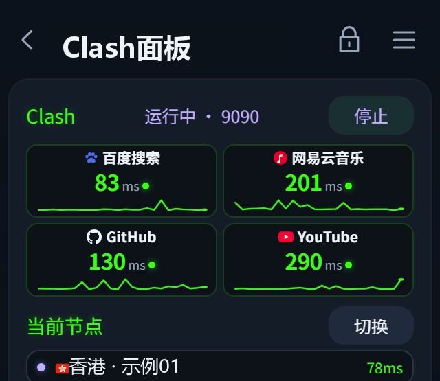

# E5 信息屏 · Clash 面板

给 **E5 随身 WiFi（跑本项目 OpenWrt 25.12 镜像）** 的信息屏加一页 Clash 面板：
一眼看到代理是开是关、当前节点多少毫秒、订阅还剩多少，还能直接在屏幕上切节点、切配置、启停内核。

> A Clash dashboard page for the E5 portable-WiFi info screen (OpenWrt 25.12 / armsr armv8).
> One self-extracting installer, no `.apk` toolchain needed.



<sub>截图中的节点、配置、流量与出口 IP 均为示例值（IP 取自文档保留段 203.0.113.x / 198.51.100.x）。</sub>

**[⬇ 直接下载安装包](https://github.com/liuyao-skydata/E5-Clash-Panel/releases/latest)** ·
[安装说明](https://github.com/liuyao-skydata/E5-Clash-Panel#安装) ·
[技术说明](docs/技术说明.md)

## 功能

| 区块 | 说明 |
|---|---|
| 状态行 | `Clash 运行中 · 9090`，绿字=在跑 / 灰字=已停止；右侧「停止 / 启动」按钮 |
| 四站实时延迟 | 百度 / 网易云 / GitHub / YouTube，经当前节点真测，每 10 秒一轮，2×2 卡片 + 24 点折线（1.3s 内绿、超时灰线） |
| 当前节点 | 名字 + 本次延迟 + 国旗；「切换」展开两列节点列表，选中两次 OK 生效（不重启内核） |
| 当前配置 | 文件名 + 最后写入时间 + 订阅额度进度条 +「剩余 / 总量（百分比）• 到期时间（剩余 N 天）」；「切换」列出 `/etc/openclash/config/*.yaml`，两次 OK 应用（uci `config_path` + 内核 restart） |
| 出口 IP 四卡 | PConline / IPIP.NET（直连 → 本机公网 IP）、IP.SB / IPIFY（走节点 → 落地 IP），一眼看出分流有没有生效 |

细节：

- **按键操作**与 Lucky 页一致：OK 选中、**两次 OK** 确认、返回键取消，光标位置在刷新后保持。
- **国旗**不用 emoji 字体（设备上没有），前端把 `🇯🇵` 这类组合换成本地 `flags/<iso>.svg`（twemoji）。
- **整页节奏集中在一处**（`section[data-title="clash_mon"]`），组间 7px、标签与卡片 4px，408px 可视区刚好铺满。
- 顺手修了 **浏览器时钟差 8 小时**：镜像里没有 tzdata，WebKit 只认 tz 文件，补一个 115 字节的 `Asia/Shanghai` TZif 并在 `session` 里导出 `TZ`。

## 兼容性

| 项 | 要求 |
|---|---|
| 设备 | 荣悦 / E5 随身 WiFi，跑本项目 OpenWrt 镜像 |
| 系统 | OpenWrt 25.12（`armsr/armv8`，`aarch64_generic`，apk 包管理） |
| 已有 | 信息屏（`/usr/share/e5-infoscreen`）—— 可以已装，也可以全新装 |
| 可选 | OpenClash（没装面板显示「未运行」）、`curl`（延迟 / IP 卡要用） |

> 为什么不是 `.apk`：该镜像用 apk v3，设备上的 `apk` 3.0.5 **没有 `mkpkg`**，也没法在本机做 v3 签名。
> 纯文件类负载用自解压脚本更稳：一个文件、自带 SHA-256 校验、装前自动备份、还能一键还原。

## 安装

**最快**：打开 [Releases](https://github.com/liuyao-skydata/E5-Clash-Panel/releases/latest) 下载 `e5-panel-install.sh`，传到设备后 root 执行一次。

或者用仓库里的 [`release/e5-panel-install.sh`](release/e5-panel-install.sh)：

```bash
# 电脑 scp（局域网）
scp -O e5-panel-install.sh root@10.10.10.1:/tmp/
ssh root@10.10.10.1 'sh /tmp/e5-panel-install.sh'

# 或者手机连 USB、开了 adb
adb push e5-panel-install.sh /tmp/
adb shell 'sh /tmp/e5-panel-install.sh'
```

装完输出：

```
✓ 安装完成，面板已上线（版本 1.0.0 + Clash 面板）
  · 设备屏幕： 应用 → Clash面板（第 10 页）
  · 页面地址： http://127.0.0.1:8088（只在本机，不对外开）
  · 还原用：   sh /tmp/e5-panel-install.sh --restore
```

> ⚠️ 别用记事本打开再另存这个 `.sh`：Windows 换行会把脚本和里面的压缩包一起改坏。
> 包内自带 SHA-256 自检，改坏了会直接拒绝安装，不会写坏系统。

### 还原 / 卸载

```sh
sh /tmp/e5-panel-install.sh --restore          # 回到最近一次安装前的状态
sh /tmp/e5-panel-install.sh --uninstall --yes  # 删程序文件（壁纸/插件/设置保留）
sh /tmp/e5-panel-install.sh --help
```

每次安装前备份到 `/root/e5-panel-backups/<时间>/`（保留最近 5 份）。

## 装了什么

| 路径 | 作用 |
|---|---|
| `/usr/share/e5-infoscreen/www/` | 信息屏前端（app.js / mobile.js / style.css / index.html / flags…） |
| `/usr/share/e5-infoscreen/api.uc` | 后端（uhttpd ucode handler，`:8088`），含 `/api/clash-net`、`/api/clash-ip`、`/api/openclash`、`/api/clash-config` |
| `/usr/share/e5-infoscreen/{settings,updates}.uc`、`default.config`、`xkb/` | 设置页、更新检查、键盘布局 |
| `/usr/libexec/e5-clash-status` | Clash 状态采集（节点 / 延迟 / 订阅 / IP） |
| `/usr/libexec/e5-infoscreen/` | `session`（cage+cog 启动，时区在这里导出）、`plugin`、`update` 等 |
| `/etc/init.d/e5-infoscreen` | 服务脚本（seatd + uhttpd:8088 + cog 三个 procd 实例） |
| `/www/luci-static/resources/view/e5-infoscreen/` | LuCI 设置页 |
| `/usr/share/luci/menu.d/`、`/usr/share/rpcd/acl.d/` 下 `*e5-infoscreen*` | 菜单与权限 |
| `/usr/share/zoneinfo/Asia/Shanghai` | 115 字节 TZif（修 8 小时时差） |

**不会碰**：`/etc/e5-infoscreen/`（壁纸、已装插件）、`/etc/config/e5-infoscreen`（你的设置）。
全新安装时才把 `default.config` 铺成 `/etc/config/e5-infoscreen`。

## 自己重新打包

`release/` 里就是成品；要改文案或页面后重新出包：

```bash
cd installer
python build.py        # 读 ../release/e5-panel-<ver>.tar.gz + install-header.sh → ../release/e5-panel-install.sh
cd ../release && sha256sum e5-panel-install.sh e5-panel-*.tar.gz > SHA256SUMS
```

- `install-header.sh`：安装器模板（含 `@SHA256@` / `@SKIP@` 两个占位符，`build.py` 回填）。
- 打包结构：模板末尾一行 `__PAYLOAD__`，运行时 `tail -n +$SKIP "$0" | tar -xzf - -C /` 取载荷，取之前先 `sha256sum` 比对。
- 载荷是「相对 `/` 的路径树」，用 `tar -czf` 生成即可；插件目录 `www/plugins` 不打进去，服务启动时由 `plugin link` 重建。

## 已知问题

| 现象 | 排查 |
|---|---|
| 装完屏幕黑 | `logread -f \| grep -i 'e5-infoscreen\|cog\|uhttpd'` |
| 面板开了但没数据 | 没装 OpenClash / 没装 `curl`；手动跑 `/usr/libexec/e5-clash-status` 看输出 |
| 时钟还是差 8 小时 | `uci get system.@system[0].zonename` 应为 `Asia/Shanghai`；`ls -l /tmp/localtime` |
| 想退回去 | `sh e5-panel-install.sh --restore` |

## 许可

本仓库的安装器、构建脚本与文档：MIT（见 [LICENSE](LICENSE)）。
打包进载荷的上游信息屏代码：MIT © 2026 Enceka —— 见 [NOTICE](NOTICE)，载荷里也带着原始 `LICENSE.t551m`。

> 想改页面/接口：看 [docs/技术说明.md](docs/技术说明.md)（数据流、接口表、时区那段坑）。
> 要发布新版本：看 [docs/发布指南.md](docs/发布指南.md)（含一键上传脚本用法）。

## 更新日志

**v1.0.0**（2026-11-12）
- 新增 Clash 面板：状态/启停、四站实时延迟折线、节点切换与测速、配置切换、订阅额度、出口 IP 四卡
- 停止后不再多显示一行「Clash / 未运行」：状态行已写「已停止」、按钮已变「启动」，四站卡与节点/配置区随之上移
- 修复 WebKit 时区（补 `Asia/Shanghai` TZif + `session` 导出 `TZ`）
- 信息屏页面标题统一为「Clash面板」
